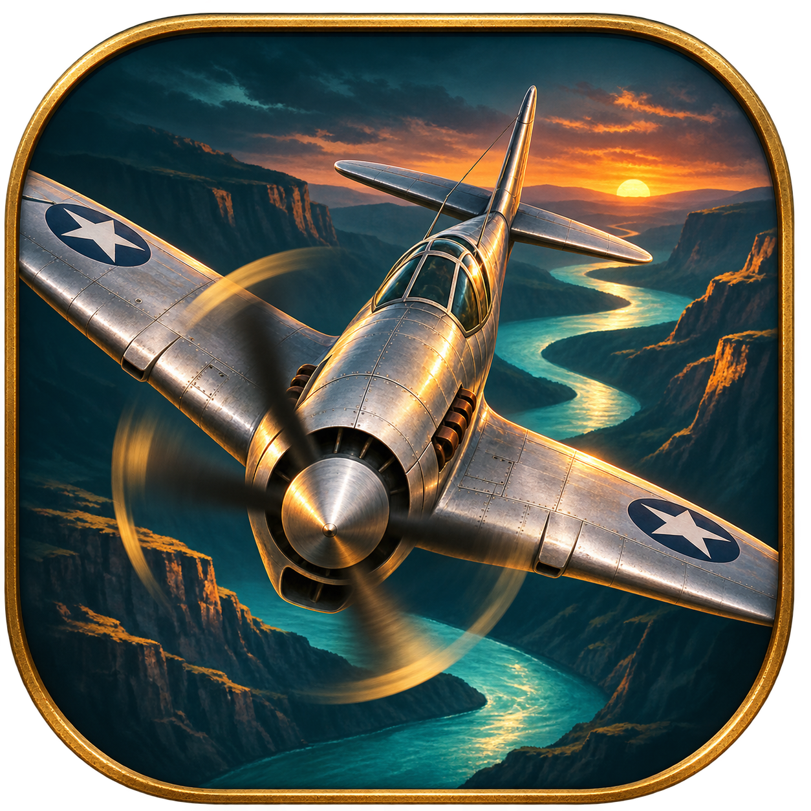

# RiverRush — Playtest

**[Скачать последнюю тестовую сборку / Download builds](https://github.com/fatalisman/RiverRush-Releases/releases)**

Здесь опубликованы готовые сборки игры. Unreal Editor не нужен.
Исходники и редактируемые сторонние ассеты в этот репозиторий не входят.

## Windows x64

Скачайте `RiverRushSetup-<версия>-Win64.exe` в разделе Releases и установите игру.
Требуются Windows 10/11 x64 и видеокарта с DirectX 12 / Shader Model 6.
Профиль и прогресс сохраняются между обновлениями.

## Linux x86_64

Когда Linux-архив появится в Releases, распакуйте его в домашнюю папку,
сделайте `RiverRush.sh` исполняемым (`chmod +x RiverRush.sh`) и запустите его.
Windows-установщик не является нативной Linux-сборкой.

## Управление

- A / D — поворот.
- Удерживать W — максимальная скорость, S — минимальная; отпустить — крейсерская.
- Мышь — прицел, ЛКМ — пушки, ПКМ — ракеты.
- Пробел — подъём, Esc — меню.

## Сообщить об ошибке

[Создайте Issue](https://github.com/fatalisman/RiverRush-Releases/issues/new):
версия игры, ОС, видеокарта и драйвер, шаги повторения, скриншот или видео.
Прикрепляя журналы, предварительно проверьте их на личные данные.

Это тестовая версия: баланс и сохранения могут меняться. Авторские права на
сторонние материалы сохраняются за их правообладателями; credits включены в игру.
